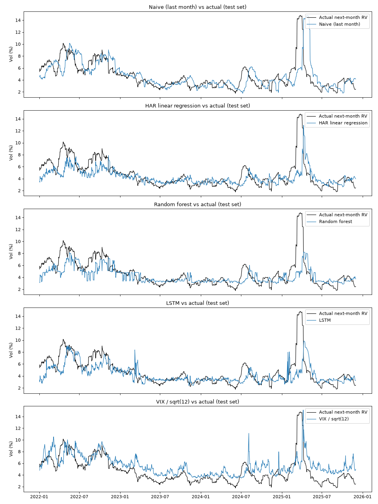

# Stock volatility forecasting

A notebook that forecasts how volatile the S&P 500 ETF (SPY) will be over the next month. I compare a naive baseline, a HAR linear regression, a random forest and a small Keras LSTM, and score the VIX index as an extra reference since it is the options market's own forecast. It uses yfinance, pandas, scikit-learn, TensorFlow and matplotlib.



## How it works

1. Download daily closing prices for SPY and the VIX index from 2010-01-01 to 2025-12-31 with `yfinance`.
2. Compute daily log returns and the 21-day realised volatility, the square root of the sum of the last 21 squared log returns, in percent. This is a monthly figure, not annualised.
3. Build three HAR features from past returns only: daily (today's squared return), weekly (last 5 days) and monthly (last 21 days), all scaled to a 21-day horizon.
4. Set the target to the realised volatility over the next 21 trading days. All rolling features look backwards, so there is no lookahead, and the target is only ever used as the label.
5. Split chronologically: train 2010 to 2019, validation 2020 to 2021, test 2022 to 2025. The last 21 rows of train and validation are dropped so no label overlaps the next period.
6. Fit the models:
   - Naive: next month's volatility equals the last 21 days' volatility.
   - HAR: `LinearRegression` on the three features.
   - Random forest: `RandomForestRegressor` with 200 trees, `max_depth` chosen on the validation set (it picked 3).
   - LSTM: `LSTM(32)` then `Dense(16)` and `Dense(1)`, fed 21-day windows of the scaled features, with early stopping on validation loss. The scaler is fitted on training rows only.
7. Convert the VIX to the same scale with VIX/100/sqrt(12) and score it as a forecast too.

## Results

Test set, 2022-01-03 to 2025-12-01 (982 trading days). Errors are in monthly volatility percentage points.

| Model | MAE | RMSE | MAE vs naive |
|---|---|---|---|
| Naive (last month) | 1.401 | 2.242 | 0.0% |
| HAR linear regression | 1.254 | 1.953 | -10.5% |
| Random forest | 1.189 | 1.903 | -15.1% |
| LSTM | 1.219 | 1.980 | -13.0% |
| VIX / sqrt(12) | 1.520 | 1.983 | +8.5% |

The random forest had the lowest error, though the three models are close to each other. The VIX forecast was on average 0.894 points higher than the volatility that followed, which is why its MAE is the worst even though its RMSE beats the naive forecast. None of the models predicted the April 2025 spike before it started.

## Repository layout

| Path | What it is |
|---|---|
| `volatility_forecasting.ipynb` | Data download, features, split, all four models, VIX comparison and plots |
| `test_predictions.png` | Each forecast plotted against actual next-month volatility on the test set |
| `requirements.txt` | Python packages used by the notebook |

## Running it

```
pip install -r requirements.txt jupyter
jupyter notebook volatility_forecasting.ipynb
```

The notebook needs an internet connection because `yfinance` downloads the prices when it runs. It finished in about 30 seconds on a laptop CPU.

## Limitations

Each model is trained once on 2010 to 2019 and never refitted, so the test period is forecast with parameters that are several years old. The targets are overlapping 21-day windows, so neighbouring test days are strongly correlated and the 982 test points are not independent. The LSTM is not fully deterministic on CPU, so its numbers move slightly between runs. The VIX is calculated from S&P 500 index options, so it is a reference for SPY rather than an exact match.

This was written by AI for learning practice.
